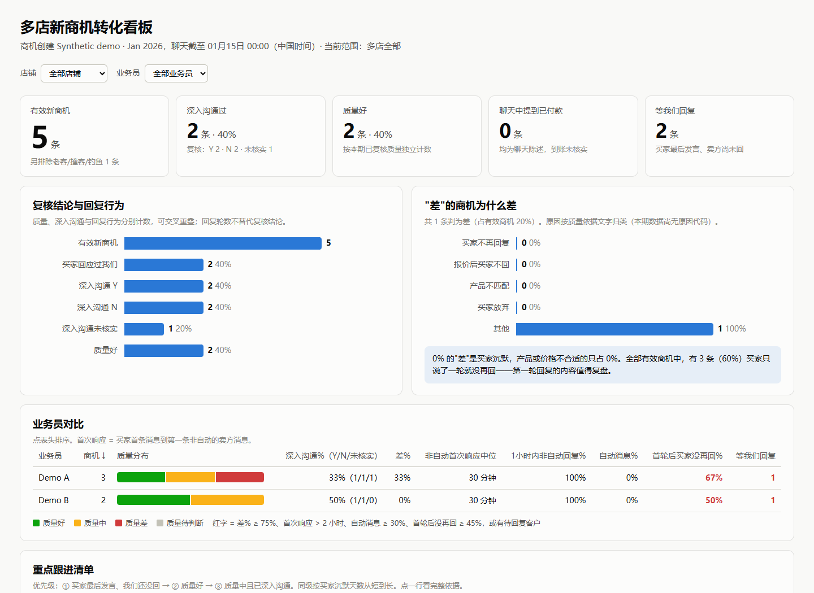
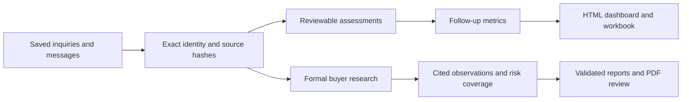

<div align="center">

# Lead Evidence Workbench

**Turn lead conversations into traceable follow-up decisions.**

A local toolkit for lead tracking, evidence validation, buyer research and reviewable reports.

[](https://github.com/alan113523/lead-evidence-workbench/actions/workflows/ci.yml)
[](LICENSE)
[](https://nodejs.org/)
[](https://www.python.org/)

[Quick start](#quick-start) · [Formal review](#formal-buyer-review) · [Documentation](#documentation) · [简体中文](README.zh-CN.md)

</div>

## Why this project

A lead, a person and a company are different records. A promising conversation is not a verified sale. A search result is not an identity match.

Lead Evidence Workbench keeps those distinctions visible. It binds observations to exact account and inquiry keys, preserves the source and timestamp of each conclusion, and generates a follow-up dashboard and workbook that a human can review.

The public repository contains source code, synthetic examples and tests. Your customer data, research observations, browser sessions and generated reports stay in your local workspace.

## What you can do

| Capability | Result |
|---|---|
| Import saved inquiries | An idempotent SQLite lead ledger with explicit store boundaries |
| Review conversations | Product, lead quality and communication-depth assessments backed by references |
| Reuse evidence | A rebuildable history index that detects changed files, gaps and conflicting versions |
| Organize buyer context | Separate business-model and purchase-purpose assessments, with unknowns preserved |
| Measure follow-up | First non-automatic seller response, buyer silence, conversation turns and coverage gaps |
| Share an internal report | A standalone HTML dashboard and an Excel follow-up workbook |
| Run formal buyer research | A staged workflow for immutable inputs, cited research, entity matching, risk coverage and PDF review |

The toolkit validates and presents supplied evidence. Research judgments come from a human or an explicitly chosen assistant; there is no bundled model service or automatic outreach.

## Quick start

Requires **Node.js 24+** and **Python 3.12+**. The offline demo needs no account, API key or browser.

```bash
git clone https://github.com/alan113523/lead-evidence-workbench.git
cd lead-evidence-workbench
python -m venv .venv
```

Activate the environment:

```bash
# macOS / Linux
source .venv/bin/activate
```

```powershell
# Windows PowerShell
.venv\Scripts\Activate.ps1
```

Install Python dependencies and run the demo:

```bash
python -m pip install -r requirements.txt
npm run demo -- first-demo
```

Open `data/first-demo/dashboard.html` in your browser. The same directory contains `follow-up.xlsx`, the synthetic source, bound messages and calculated metrics. Use a new demo name for each run: existing outputs are preserved.



*The screenshot and demo records are entirely synthetic. The current dashboard and workbook labels are Chinese; the CLI and documentation are available in English and Chinese.*

The Node core uses built-in modules; no `npm install` is required for this demo. If your Python executable has another name, set `PYTHON_EXECUTABLE` explicitly; see [Getting started](docs/getting-started.md).

## How it works



Each conclusion keeps its source, observation time and uncertainty. Excluded records remain in a separate ledger. Missing information stays unknown. A payment statement never becomes a verified receipt automatically.

### Import your own saved inquiries

After running the demo, try the local SQLite importer:

```bash
node scripts/inquiries.mjs import --file data/first-demo/inquiries-demoalpha.jsonl --store demoalpha --db data/first-demo/leads.sqlite
```

The importer rejects rows from a different store. For your own inputs, use the [single-store JSONL contract](docs/getting-started.md#inquiry-import).

## Formal buyer review

The optional [`formal-review/`](formal-review/README.md) package includes input validation, browser-collection adapters, cited research records, entity matching, nine-dimension analysis, risk checks, report generation and PDF validation.

Try an entirely offline workflow with no matched entities:

```bash
python -X utf8 formal-review/examples/synthetic_demo.py --out data/formal-demo --customers 3 --matched 0
```

For a real task, supply an authorized JSON/XLSX pair and a new workspace, then follow the `next` instruction at each stage:

```bash
python -X utf8 formal-review/scripts/workflow.py init --input data/input.json --xlsx data/input.xlsx --workspace data/research
python -X utf8 formal-review/scripts/workflow.py next --run data/research/RUN_DIRECTORY
```

Real research requires an operator and accessible sources. Browser collection requires your own logged-in, explicitly verified account. PDF rendering requires a local Chrome/Edge installation and appropriate fonts. A PDF completion receipt also requires human page inspection; setting a flag does not bypass the validators. See the [formal workflow guide](formal-review/README.md).

## Privacy by design

- No real customer datasets, account identifiers, browser profiles or company operating reports are distributed.
- Runtime records and reports belong under Git-ignored `data/`; generated files are private by default.
- Store keys are caller-supplied. `demoalpha`, `demobeta` and `demogamma` are invented examples.
- The public project starts with a fresh history. Internal commits, handoffs, screenshots and frozen company runs are excluded.
- The ordinary demo performs no network calls. Optional browser and public-research workflows require explicit operator action.

Read the [privacy model](docs/privacy.md) before importing real business data. A public source repository does not make your generated dashboard safe to publish.

## Development

```bash
npm test                 # Node, Python core and formal workflow tests
npm run test:node
npm run test:python
npm run test:formal
npm run check:privacy    # Tracked-path and personal-machine-path checks
```

Tests use temporary synthetic fixtures. Platform-specific integrations and real browser/account flows are separate from the offline test suite. Windows runners use explicit UTF-8 Python mode.

## Documentation

- [Getting started and input examples](docs/getting-started.md)
- [Architecture and evidence boundaries](docs/architecture.md)
- [Privacy and publication policy](docs/privacy.md)
- [Formal buyer-review workflow](formal-review/README.md)
- [Release verification](docs/validation.md)
- [Contributing](CONTRIBUTING.md) · [Security policy](SECURITY.md) · [Changelog](CHANGELOG.md)

## Scope and status

This is an early public toolkit, not a hosted CRM service. It does not send buyer messages, write CRM records, confirm bank receipts or make legal/credit decisions. Internal frozen-run compatibility is deliberately excluded: public evidence runs must pin the published source version.

The public layout and onboarding were informed by [Datasette](https://github.com/simonw/datasette), [Twenty](https://github.com/twentyhq/twenty) and [Playwright](https://github.com/microsoft/playwright): a clear purpose, runnable example, visible limitations and a direct path to development docs. Their branding and product code are not bundled.

## License

[MIT](LICENSE). Retained component copyrights and template icon notices are listed in [NOTICE.md](NOTICE.md) and the [formal template notices](formal-review/assets/THIRD_PARTY_NOTICES.md). Browser binaries, fonts and external sanctions datasets are not distributed.
