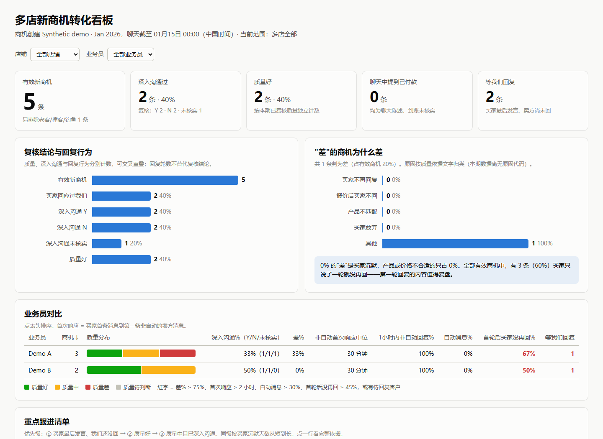

# Lead Evidence Workbench

**把商机、聊天和买家研究整理成可追溯的跟进结论。**

一个在本机运行的商机跟踪、证据校验、正式背调和报告工具集。[English](README.md)

## 适合什么场景

你已有商机导出和聊天，希望持续跟进客户，同时保留“为什么这样判断”的依据。项目按精确账号和商机绑定资料，区分公司经营模式与本次采购用途，计算跟进行为指标，并生成 HTML 看板和 Excel 跟进表。

正式背调模块另行管理输入校验、实际查询记录、主体匹配、九维研究、风险覆盖、报告及 PDF 视觉验收。商机质量、深度沟通、企业身份和付款核验分别记录，不自动互相推导。

| 模块 | 提供的能力 |
|---|---|
| 商机台账 | 幂等导入、SQLite 存储、跨店身份边界 |
| 沟通复核 | 产品、质量、深度沟通及逐项证据引用 |
| 历史索引 | 复用已有证据，发现缺页、变更和版本冲突 |
| 买家画像 | 公司经营模式、本次采购用途、来源与不确定性 |
| 跟进指标 | 首次非自动响应、买家沉默、往返回合及覆盖缺口 |
| 经营交付 | 可本地打开的 HTML 看板、Excel 跟进表 |
| 正式背调 | 原始输入冻结、查询依据、主体匹配、风险检查、报告及 PDF 门禁 |

## 五分钟离线演示

需要 **Node.js 24+、Python 3.12+**。演示不需要登录账号、浏览器或 API Key。

```bash
git clone https://github.com/alan113523/lead-evidence-workbench.git
cd lead-evidence-workbench
python -m venv .venv
```

激活环境后安装依赖：

```powershell
# Windows PowerShell
.venv\Scripts\Activate.ps1
python -m pip install -r requirements.txt
npm run demo -- first-demo
```

```bash
# macOS / Linux
source .venv/bin/activate
python -m pip install -r requirements.txt
npm run demo -- first-demo
```

打开 `data/first-demo/dashboard.html`，同目录可查看 `follow-up.xlsx`、合成商机、绑定消息和计算指标。每次使用新的演示名称，避免覆盖旧结果。Node 核心只使用内置模块，无需执行 `npm install`。



演示中的公司、买家、聊天和判断全部虚构。当前看板及工作簿使用中文标签。真实资料只应保存在本机被 Git 忽略的目录中。

## 正式背调

正式流程位于 [`formal-review/`](formal-review/README.md)，包含本机脚本、规则、合成测试、报告模板及第三方版权声明。

先运行无匹配客户的离线演示：

```bash
python -X utf8 formal-review/examples/synthetic_demo.py --out data/formal-demo --customers 3 --matched 0
```

真实任务需提供已授权的 JSON/XLSX 输入，再按 `next` 指令逐步推进。公开研究由操作人员或明确选择的 AI 助手完成，脚本负责证据、阶段和产物校验，不自带模型服务。

可选在线采集需要用户自己的登录态和经核验的店铺/浏览器绑定；PDF 需要本机 Chrome/Edge 和合适字体。生成 PDF 后仍须逐页查看并提交绑定该 PDF 哈希的视觉验收记录，不能改状态字段跳过验收。

## 隐私边界

- 公开仓库只有代码、文档、合成样例和测试，不附带真实客户、账号身份、经营数据或浏览器用户目录。
- 运行资料、研究证据和生成报告放入被忽略的 `data/`，不随 Git 上传。
- 示例店铺 `demoalpha`、`demobeta`、`demogamma` 均为虚构；使用者显式指定自己的店铺键并核验身份。
- 公开版使用独立提交历史，不携带内部交接、旧业务运行或本机配置。
- 公开源码不等于允许公开业务看板。真实生成结果可能含客户资料，应按私有文件管理。

更多细节见[隐私说明](docs/privacy.md)。

## 开发与文档

```bash
npm test
npm run check:privacy
```

测试使用临时合成数据；真实账号、浏览器采集和外部名单下载不由离线测试替代。Windows 测试入口显式使用 UTF-8。

- [安装、商机导入和输入示例](docs/getting-started.md)
- [架构与证据边界](docs/architecture.md)
- [正式背调流程](formal-review/README.md)
- [发布验证记录](docs/validation.md)
- [贡献说明](CONTRIBUTING.md)、[安全问题](SECURITY.md)、[更新记录](CHANGELOG.md)

这是公开工具集的早期版本，不提供托管 CRM、自动客户发送、CRM 写入或实际到账确认。缺失信息保留未知，同名主体保留待核，聊天付款陈述不自动变成到账证明。

项目介绍与上手结构参考 [Datasette](https://github.com/simonw/datasette)、[Twenty](https://github.com/twentyhq/twenty) 和 [Playwright](https://github.com/microsoft/playwright)，没有复制其品牌和业务实现。代码采用 [MIT 许可](LICENSE)，组件版权及图标声明见 [NOTICE.md](NOTICE.md)。
